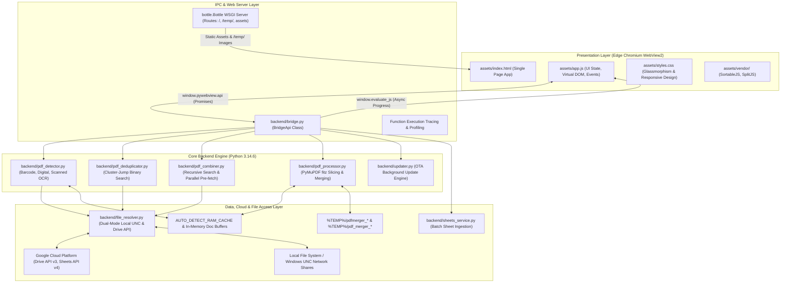

# PDF Manipulation Desktop Application — System Architecture & Technical Specifications

---

## Document Information
* **Document Version:** 1.0.8
* **Target Application:** PDF Manipulation Tool Desktop Edition
* **Target Operating System:** Microsoft Windows 10 / 11 (64-bit)
* **Author / Ownership:** Thinh Phung / Avery Dennison (AD) RFID FRU Team
* **Last Updated:** 2026-09-10

---

## Table of Contents
1. [Overview](#1-overview)
   - [1.1 Purpose & High-Level Scope](#11-purpose--high-level-scope)
   - [1.2 Tech Stack & Primary Language](#12-tech-stack--primary-language)
   - [1.3 System Architecture & Key Modules](#13-system-architecture--key-modules)
   - [1.4 Project Structure & Module Responsibilities](#14-project-structure--module-responsibilities)
   - [1.5 Critical Execution & Runtime Flags](#15-critical-execution--runtime-flags)
   - [1.6 Comprehensive Data Flow Trajectory](#16-comprehensive-data-flow-trajectory)
2. [Prerequisites & Environment Setup](#2-prerequisites--environment-setup)
   - [2.1 Hardware & OS Requirements](#21-hardware--os-requirements)
   - [2.2 Google Cloud Platform (GCP) Configuration](#22-google-cloud-platform-gcp-configuration)
   - [2.3 Local Development Setup](#23-local-development-setup)
   - [2.4 Enterprise Security Policy](#24-enterprise-security-policy)
3. [Execution & Build Pipeline](#3-execution--build-pipeline)
   - [3.1 Local Development Execution](#31-local-development-execution)
   - [3.2 PyInstaller Packaging Pipeline](#32-pyinstaller-packaging-pipeline)
   - [3.3 Compilation & Build Troubleshooting](#33-compilation--build-troubleshooting)
4. [Detailed Module & Logic Specifications](#4-detailed-module--logic-specifications)
   - [4.1 Constants & Global Configurations](#41-constants--global-configurations)
   - [4.2 Core Logic & Algorithmic Analysis](#42-core-logic--algorithmic-analysis)
   - [4.3 Comprehensive Logic-to-UI Mapping](#43-comprehensive-logic-to-ui-mapping)
   - [4.4 Storage & Resource Management](#44-storage--resource-management)

---

# 1. Overview

### 1.1 Purpose & High-Level Scope
The **PDF Manipulation Desktop Application** is an enterprise-grade utility developed for the Avery Dennison (AD) RFID / Fast React Utility (FRU) division. The software automates the extraction, sorting, deduplication, merging, and assembly of complex manufacturing and sales documentation PDFs (Packaging Front Layouts / PFL, Sales Order Lines / SOL, engineering film drawings, and production dockets).

#### Core Problems Solved:
1. **Google Apps Script (GAS) Execution Limits:** The legacy cloud-scripted solution suffered from Google's strict 6-minute maximum execution timeout, Drive API rate limits, and slow web roundtrips when parsing multi-hundred-page PDFs.
2. **High-Latency Network Storage (UNC / NAS):** Manufacturing environments host multi-gigabyte document trees across on-premise Windows Network Shares (`\\server\share`). Serial I/O over remote shares led to application freezing and memory exhaustion.
3. **Automated Barcode Page-Range Isolation:** Production order bundles contain multiple Sales Orders (SO) and Sales Order Lines (SOL) concatenated within single files. The desktop tool provides automated 1D/2D barcode boundary scanning to extract specific page subsets without human error.
4. **Desktop Autonomy:** Operates as a self-contained, high-performance Windows desktop application utilizing multi-core hardware threading, native PyMuPDF vector extraction, and Microsoft Edge Chromium WebView2 rendering.

#### Primary Functional Modules:
* **PDF Merger (PFL):** Automated multi-folder barcode matching, layout sorting, front-drawing prioritization, and an interactive 3-panel manual assembly workspace. Presets read single-column SOL lists (`A:A`). Layout folders support Google Drive and local UNC.
* **PDF Merger (RFID HT):** Dedicated module for the RFID Heat Transfer line. Presets read 4 columns (`SOL`, `Job`, `RB`, `Flag`). SOview scanning executes single-pass Barcode Range Scan for `Flag=True` items while maintaining Fast Mode / OCR Mode for `Flag=False`. Layout folder is local UNC, matched 1-to-1 by `Job` code, extracting all pages directly without barcode/OCR scanning.
* **PDF Deduplicate:** High-speed removal of identical repeated pages in production docket batches using fast-path text regex and an $O(K \log(N/K))$ exponential cluster-jump algorithm.
* **PDF Combine:** Recursive multi-folder search for SOL matching, parallel network pre-fetching, and bulk split/merge assembly.
* **Over-The-Air (OTA) Updater:** Silent remote version checking against Google Drive with detached self-updating process replacement.

---

### 1.2 Tech Stack & Primary Language

| Component Layer | Technology | Exact Version | Justification / Role |
| :--- | :--- | :--- | :--- |
| **Runtime Language** | Python (CPython 64-bit) | **3.14.6** | Core business logic, threading, process orchestration |
| **Desktop Host GUI** | `pywebview` | **6.2.1** | Native Windows WinForms host embedding Microsoft Edge Chromium WebView2 |
| **Internal WSGI Server** | `bottle` | **0.13.4** | Ultra-lightweight local microserver serving static assets and session temp images |
| **PDF Rendering & Assembly** | `pymupdf` (fitz) | **1.28.2** | High-performance C-based MuPDF engine for page extraction, rendering, and vector assembly |
| **Barcode Recognition** | `pyzbar` | **0.1.9** | C-library wrapper (libzbar-64) for decoding 1D (Code 128/39) and 2D (QR/DataMatrix) barcodes |
| **Optical Character Recognition** | `pytesseract` | **0.3.13** | Python wrapper for Google Tesseract OCR v5 engine (scanned PDF fallback) |
| **Image Processing** | `Pillow` (PIL) | **12.3.0** | Pixel-level manipulation, color space conversion, and ROI image clipping |
| **Google Sheets API** | `gspread` | **6.2.1** | Reading user presets and SOL lists via Google Sheets v4 API |
| **Google Drive API** | `google-api-python-client` | **2.198.0** | Recursive folder traversal and chunked stream download via Drive v3 API |
| **Authentication** | `google-auth`, `google-auth-httplib2` | **2.56.3**, **0.4.1** | GCP Service Account JWT authentication and token lifecycle |
| **Frontend Framework** | Vanilla HTML5 / ES6+ JavaScript | Modern Web Standards | Zero-dependency, lightweight, high-performance UI |
| **Drag & Drop Reordering** | `SortableJS` | **1.15.2** (`vendor/sortable.min.js`) | Touch-friendly drag-and-drop page assembly reordering |
| **Resizable Panes** | `Split.js` | **1.6.5** (`vendor/split.min.js`) | Smooth gutter resizing for the 3-panel manual workspace |
| **Executable Packager** | `pyinstaller` | **6.22.0** | Single-file Windows binary compilation with dynamic bundling |

---

### 1.3 System Architecture & Key Modules

The application adopts a decoupled **Hybrid Desktop-Web Architecture**:



#### Layer Responsibilities:
1. **Presentation Layer (`assets/`):** Runs inside an embedded WebView2 runtime. Renders 6 dedicated screens (`dashboard-screen`, `input-screen`, `workspace-screen`, `auto-detect-results-screen`, `deduplicate-screen`, `combine-screen`). Employs virtualized DOM rendering to render large page grids without memory bloat.
2. **IPC & Web Server Layer (`main.py`, `backend/bridge.py`):** Exposes Python methods as asynchronous JavaScript Promises via `window.pywebview.api`. Dispatches background worker tasks (`threading.Thread`) so the UI never freezes. Concurrently hosts an in-memory `bottle` WSGI HTTP server on localhost to serve cached thumbnail JPEGs from `%TEMP%`.
3. **Core Backend Engine (`backend/`):** Houses the multi-threaded algorithms for barcode detection (1D/2D), streaming PDF generators, OCR fallback workers, and vector-level PDF page concatenation using PyMuPDF.
4. **Data Access & Cloud Integration:** Connects seamlessly to both on-premise Windows network shares (`\\server\share\...`) and Google Cloud APIs (Sheets v4, Drive v3) using authenticated Service Account credentials.

---

### 1.4 Project Structure & Module Responsibilities

```
pdf_manipulation_desktop/
│
├── main.py                             # Application entry point: initializes WebView2, Bottle server, and temp directories
├── build.spec                          # PyInstaller packaging configuration (bundling, hiddenimports, exclusions)
├── version_info.txt                    # Windows PE binary metadata (Version, Copyright, Company, Author)
├── CHANGELOG.md                        # Version release history and change tracking
├── Document requirement.md             # Project documentation specifications and criteria
│
├── backend/                            # Core Python Application Engine
│   ├── __init__.py                     # Package initializer
│   ├── bridge.py                       # BridgeApi: Public JS-Python API methods, thread dispatch, and execution tracing
│   ├── file_resolver.py                # Dual-mode PDF resolver: local UNC rglob search and Google Drive v3 API query
│   ├── pdf_detector.py                 # Auto-detect engine: dual-mode SOview barcode (Fast/V2-OCR), digital text, Tesseract OCR scanning
│   ├── pdf_deduplicator.py             # Deduplication engine: cluster-jump exponential + binary search algorithm
│   ├── pdf_combiner.py                 # PDF combiner engine: recursive folder scanning and parallel UNC pre-fetching
│   ├── pdf_processor.py                # Low-level PyMuPDF processor: thumbnail generation, hires rendering, export assembly
│   ├── sheets_service.py               # Google Sheets API connector: batch ingestion of Presets and SOL lists
│   └── updater.py                      # Over-The-Air (OTA) updater: checks remote version on Drive and launches detached updater
│
├── config/                             # Application Configuration
│   ├── credentials.json                # GCP Service Account Private Key (Strictly restricted, git-ignored)
│   └── version.json                    # Local semantic application version indicator (e.g. {"version": "1.0.7"})
│
├── assets/                             # Frontend Presentation Files (Embedded in WebView2)
│   ├── index.html                      # Single-page HTML application structure hosting 6 modular screens
│   ├── styles.css                      # Modern CSS design system (HSL color variables, glassmorphism, responsive grids)
│   ├── app.js                          # Frontend client logic (DOM controller, state management, event listeners)
│   ├── icon.ico                        # Application desktop icon (256x256 multi-resolution Windows ICO)
│   └── vendor/                         # Third-Party Frontend Dependencies
│       ├── sortable.min.js             # Drag-and-drop page reordering library
│       └── split.min.js                # Resizable split-pane gutter library
│
└── vendor/                             # Third-Party Native Binaries
    └── tesseract/                      # Standalone Tesseract OCR binary and trained language data files
```

---

### 1.5 Critical Execution & Runtime Flags

| Flag / Variable | Location | Type | Default Value | Dev vs Prod Behavior & Architectural Justification |
| :--- | :--- | :--- | :--- | :--- |
| `TRACING_ENABLED` | `backend/bridge.py:59` | `bool` | `True` (Dev) / `False` (Prod) | **Execution Profiling Decorator:** When `True`, every call to `BridgeApi` logs method names, truncated arguments, thread dispatch state, and execution wall-clock time in milliseconds to stdout. Set to `False` in production builds to eliminate logging overhead. |
| `_MAX_ARG_LEN` | `backend/bridge.py:61` | `int` | `40` | **Log Sanitization & Truncation:** Caps argument string representations in stdout logs to 40 characters to prevent massive JSON payloads or file buffers from flooding terminal logs. |
| `debug` | `main.py:90` | `bool` | `False` | **Chromium DevTools:** Passed into `webview.start(debug=False)`. When `True`, right-clicking the window enables Inspect Element and Chromium Developer Console. Disabled in production. |
| `CREATE_NO_WINDOW` | `backend/pdf_detector.py:134` | `int` | `0x08000000` | **Console Flash Suppression:** Injected into `pytesseract.pytesseract.subprocess_args` alongside `STARTUPINFO.wShowWindow = SW_HIDE`. Guarantees that invoking `tesseract.exe` will never pop up a black terminal window on Windows. |
| `upx` | `build.spec:96` | `bool` | `True` | **Binary Compression:** Directs PyInstaller to compress embedded binaries via Ultimate Packer for eXecutables (UPX), reducing the final standalone `.exe` footprint from ~110 MB to ~45 MB. |

---

### 1.6 Comprehensive Data Flow Trajectory

The following trajectory details the lifecycle of documents from cloud/network storage to RAM, local disk, UI rendering, and final assembly:

```
[1. Google Sheets / Drive / UNC Share]
      │
      │ HTTPS Batch Request (Sheets API v4) / UNC File Probe
      ▼
[2. Network Ingestion]
      │
      ├── Google Sheets: JSON Data -> Presets & SOL lists parsed in RAM
      ├── Google Drive: 5 MB chunked stream via MediaIoBaseDownload -> RAM BytesIO
      └── Local UNC Share: Binary read via open() into memory buffer
      │
      ▼
[3. Session Cache / Local Temp Disk]
      │
      ├── PDF files cached to %TEMP%\pdf_merger_*\<uuid>.pdf
      └── File metadata indexed into _RESOLVED_FILES_CACHE in RAM
      │
      ▼
[4. Processing & Algorithmic Detection]
      │
      ├── Page rasterization via PyMuPDF (fitz) at 72 / 150 DPI
      ├── Barcode recognition (pyzbar) / Text extraction (fitz) / OCR (Tesseract)
      └── Matched page sequences serialized to AUTO_DETECT_RAM_CACHE as fitz bytes
      │
      ▼
[5. Dynamic UI Rendering via Bottle WSGI]
      │
      ├── Page images written to %TEMP%\pdfmerger_*\<uuid>.jpg
      ├── Served by Bottle HTTP server at http://127.0.0.1/temp/<uuid>.jpg
      └── WebView2 DOM renders  tags in virtualized grid (app.js)
      │
      ▼
[6. Export Assembly & Final Output]
      │
      ├── User organizes Assembly Queue (SortableJS reordering)
      ├── PyMuPDF executes insert_pdf() combining vector streams in RAM
      ├── Saved directly to destination path with garbage=3, deflate=True
      └── Zero intermediate temporary PDF files created on disk
      │
      ▼
[7. Lifecycle Termination & Auto-Cleanup]
      │
      └── atexit hooks execute shutil.rmtree() clearing all %TEMP% directories
```

---

# 2. Prerequisites & Environment Setup

### 2.1 Hardware & OS Requirements
* **Operating System:** Microsoft Windows 10 (Build 19041+) or Windows 11 (64-bit).
* **System Architecture:** x86_64 (AMD64). ARM64 is supported via Windows x64 emulation.
* **WebView2 Runtime:** Microsoft Edge WebView2 Evergreen Runtime (pre-installed on Windows 11 and modern Windows 10).
* **Display & DPI Settings:**
  * Minimum Resolution: $960 \times 640$ pixels.
  * Recommended Resolution: $1440 \times 900$ pixels or higher.
  * DPI Scaling: Fully compatible with Per-Monitor DPI V2 ($100\%, 125\%, 150\%, 200\%$). PyWebView automatically negotiates coordinate scaling with WebView2.
* **Hardware Compute:**
  * CPU: Dual-core 2.0 GHz minimum; Quad-core or higher recommended (parallel OCR and export auto-scale to `os.cpu_count()`).
  * RAM: Minimum 4 GB; 8 GB+ recommended when processing multi-hundred-page engineering PDFs.

---

### 2.2 Google Cloud Platform (GCP) Configuration

#### 1. Cloud Project & IAM Identity
* **GCP Project ID:** `avy-data-rfid-fru`
* **Service Account Email:** `rfid-fru-ngocnguyen@avy-data-rfid-fru.iam.gserviceaccount.com`
* **Service Account Key Type:** JSON Private Key (`config/credentials.json`).

#### 2. Required GCP APIs
The following APIs must be enabled within the GCP Console:
1. **Google Sheets API v4** (`sheets.googleapis.com`)
2. **Google Drive API v3** (`drive.googleapis.com`)

#### 3. OAuth 2.0 Scopes
The application enforces strict **least-privilege read-only** scopes:
```python
SCOPES = [
    "https://www.googleapis.com/auth/spreadsheets.readonly",
    "https://www.googleapis.com/auth/drive.readonly",
]
```

#### 4. Google Sheets Database Configuration
* **Master Spreadsheet ID:** `1dUHAsSLSa1thA9Mmy-4_B2A9sXSqsILfRVOoz_s_gAk`
* **Required Sheets & Schema Definitions:**
  1. `Users_Preset`: Global user directory tab containing 5 columns:
     - `Col A: User` (Preset Name / Tab Name reference, e.g. "User_1")
     - `Col B: Line` (Target module line: `"PFL"` or `"RFID HT"`)
     - `Col C: SOview_Folder_Link` (Google Drive URL or Local UNC Path)
     - `Col D: Layout_Folder_Link` (Google Drive URL or Local UNC Path)
     - `Col E: Output_Folder_Link` (Local UNC / Directory Destination Path)
  2. **Per-Preset Data Sheets** (named identically to `User` in `Users_Preset`):
     - **PFL Line (`Line == "PFL"`):** Fetched via range `A:A`
       - `Col A: SOL Code` (Header in row 1, followed by 9-digit SOL strings e.g. `144187563-1`).
     - **RFID HT Line (`Line == "RFID HT"`):** Fetched via range `A:D`
       - `Col A: SOL Code` (9-digit base SO + line suffix, e.g. `144187563-1`)
       - `Col B: Job` (Alphanumeric Job ID used to match layout files, e.g. `J12345`)
       - `Col C: RB` (Ribbon / Roll Batch specification)
       - `Col D: Flag` (Boolean flag: `"true"`, `"1"`, `"yes"` for Barcode Range Scan; empty / `"false"` for Fast/OCR Mode).

---

### 2.3 Local Development Setup

#### Step 1: Python Environment Installation
Ensure Python 3.14 (64-bit) is installed and registered on the system `PATH`. Verify via terminal:
```powershell
python --version
# Expected: Python 3.14.x (or 3.11 - 3.14)
```

#### Step 2: Clone and Create Virtual Environment
```powershell
cd "c:\Users\1228411\Desktop\Merger Tool\pdf_manipulation_desktop"
python -m venv venv
.\venv\Scripts\activate
```

#### Step 3: Install Required Dependencies
Create or verify `requirements.txt` containing the pinned versions, then install:
```text
bottle==0.13.4
cryptography==50.0.0
google-api-python-client==2.198.0
google-auth==2.56.3
google-auth-httplib2==0.4.1
google-auth-oauthlib==1.4.0
gspread==6.2.1
httplib2==0.32.0
packaging==26.3
pdfminer.six==20260107
pillow==12.3.0
psutil==7.2.2
pyinstaller==6.22.0
pyinstaller-hooks-contrib==2026.6
pymupdf==1.28.2
pytesseract==0.3.13
pywebview==6.2.1
pyzbar==0.1.9
requests==2.34.2
```
Execute installation:
```powershell
pip install --upgrade pip
pip install -r requirements.txt
```

#### Step 4: External Native Binaries Setup
1. **PyZbar DLL Dependencies:** `pyzbar` requires `libiconv.dll`, `libzbar-64.dll`, and `msvcr120.dll`. Ensure Microsoft Visual C++ 2013 Redistributable (x64) is installed, or verify `msvcr120.dll` exists in `System32` or the `pyzbar` package folder.
2. **Tesseract OCR:** Install Tesseract OCR to `C:\Program Files\Tesseract-OCR\` or place portable binaries into `vendor/tesseract/`.

---

### 2.4 Enterprise Security Policy

1. **Credentials Isolation:**
   * The file `config/credentials.json` contains a high-privilege Service Account private key.
   * **Mandatory Rule:** `credentials.json` must **NEVER** be committed to Git or pushed to any public/remote repository.
2. **Mandatory `.gitignore` Rules:**
   ```gitignore
   # GCP Credentials & Secrets
   config/credentials.json
   *.pem
   *.key
   
   # Python Environment & Bytecode
   venv/
   __pycache__/
   *.pyc
   
   # PyInstaller Build Artifacts
   build/
   dist/
   *.spec.bak
   
   # Temporary Run Data
   *.log
   %TEMP%/
   ```
3. **Read-Only Scope Enforcement:** Application code never requests `drive` (write/delete) or `spreadsheets` (write) permissions. All operations are read-only, preventing accidental data alteration in enterprise repositories.

---

# 3. Execution & Build Pipeline

### 3.1 Local Development Execution
To launch the application in development mode with live tracing:
```powershell
# Activate virtual environment
.\venv\Scripts\activate

# Launch application
python main.py
```
*To enable Chromium Developer Tools during development, open `main.py` and set `debug=True` in `webview.start(debug=True)` at line 90.*

---

### 3.2 PyInstaller Packaging Pipeline

The application is compiled into a standalone, single-file Windows executable via `build.spec`.

#### Build Command:
```powershell
# Run from the root project directory:
pyinstaller --noconfirm build.spec
```
The output binary will be compiled to:
`dist/PDF Manipulation v1.0.8.exe`

#### Architectural Breakdown of `build.spec`:
1. **Dynamic Version Ingestion:**
   Reads `config/version.json` at build time to dynamically label the output binary `PDF Manipulation v{app_version}.exe`.
2. **Native DLL Bundling (`pyzbar_binaries`):**
   Explicitly extracts `libiconv.dll`, `libzbar-64.dll`, and `msvcr120.dll` from the active Python environment and packages them directly into the root `pyzbar` folder of the bundle.
3. **Data Bundles (`datas`):**
   * `('assets', 'assets')`: Bundles all HTML, CSS, JavaScript, and vendor UI libraries.
   * `('config', 'config')`: Bundles default configs and `version.json`.
   * `('vendor/tesseract', 'vendor/tesseract')`: Bundles standalone OCR binaries.
4. **Dynamic Path Resolution (`sys._MEIPASS`):**
   In dev mode, assets resolve relative to `__file__`. In compiled mode, PyInstaller unpacks files into Windows temporary storage (`sys._MEIPASS`). All backend modules resolve paths via:
   ```python
   if getattr(sys, "frozen", False):
       base = sys._MEIPASS
   else:
       base = os.path.dirname(os.path.abspath(__file__))
   ```
5. **Package Exclusions for Size Minimization:**
   Heavy unused scientific libraries are strictly excluded:
   ```python
   excludes=['matplotlib', 'numpy', 'pandas', 'PyQt5', 'tkinter', 'pdf2image']
   ```
   *Impact:* Reduces binary payload by over 180 MB.
6. **PE Version Information:**
   Compiles `version_info.txt` to inject official Windows File Properties (File Version, Product Version, Legal Copyright, Company Name).

---

### 3.3 Compilation & Build Troubleshooting

#### Issue 1: `pyzbar` Fails with `FileNotFoundError: Could not find module 'libzbar-64.dll'`
* **Root Cause:** Missing `msvcr120.dll` (Microsoft Visual C++ 2013 runtime dependency).
* **Automated Solution:** `backend/pdf_detector.py` implements `_apply_pyzbar_dll_patch()`, which dynamically scans candidate system paths (e.g., Office16, System32, SysWOW64) and copies `msvcr120.dll` into the `pyzbar` package folder before invoking `os.add_dll_directory()`.

#### Issue 2: Terminal Window Flashes When Running Tesseract OCR
* **Root Cause:** Standard `pytesseract` calls invoke `subprocess.Popen` without hiding the Windows console window.
* **Automated Solution:** `backend/pdf_detector.py` executes `_suppress_subprocess_windows()` at import time, patching `pytesseract.pytesseract.subprocess_args` with `creationflags = subprocess.CREATE_NO_WINDOW` and `STARTF_USESHOWWINDOW` with `SW_HIDE`.

#### Issue 3: Google Drive Download Drops Connection (`WinError 10054`)
* **Root Cause:** Windows socket recycling when reusing `httplib2` transport over keep-alive connections.
* **Automated Solution:** `backend/file_resolver.py` constructs a fresh `AuthorizedHttp(creds, http=httplib2.Http(timeout=30))` per service instance and applies exponential backoff retry loops.

---

# 4. Detailed Module & Logic Specifications

### 4.1 Constants & Global Configurations

| Constant / Symbol | File Location | Value / Type | Description & Technical Significance |
| :--- | :--- | :--- | :--- |
| `SPREADSHEET_ID` | `backend/sheets_service.py:23` | `"1dUHAsSLSa1thA9Mmy-4_B2A9sXSqsILfRVOoz_s_gAk"` | Master Google Spreadsheet containing Presets and SOL lists across all manufacturing lines |
| `USERS_SHEET_NAME` | `backend/sheets_service.py:24` | `"Users_Preset"` | Master directory tab containing 5 columns: `User`, `Line`, `SOview_Folder_Link`, `Layout_Folder_Link`, `Output_Folder_Link` |
| `PFL_PRESET_RANGE` | `backend/sheets_service.py:143` | `'<Preset>'!A:A` | Batch read range for PFL line sheets; extracts single-column SOL code lists |
| `RFID_HT_PRESET_RANGE` | `backend/sheets_service.py:141` | `'<Preset>'!A:D` | Batch read range for RFID HT line sheets; extracts 4 columns: `SOL`, `Job`, `RB`, `Flag` |
| `validate_so_flags()` | `backend/pdf_detector.py:39` | `Callable` | Validates the "1 SO = 1 Flag" consistency rule; raises `ValueError` if contradictory flags exist for the same 9-digit base SO |
| `_to_bool()` | `backend/sheets_service.py:62` | `Callable` | Safely converts Google Sheets cell strings to bool: returns `True` for `"true"`, `"1"`, `"yes"`; `False` for empty or other values |
| `AUTO_DETECT_RAM_CACHE`| `backend/pdf_detector.py:93` | `dict[str, bytes]` | Global in-memory cache mapping `"{sol}_{typeId}"` to serialized PyMuPDF `fitz.Document` bytes for zero-disk Auto Detect export |
| `REMOTE_VERSION_FILE_ID` | `backend/updater.py:39` | `"1AKQM_kuyrvqeK6foCt_1O1tRJN2MZ6Vm"` | Google Drive File ID hosting the remote release `version.json` |
| `REMOTE_EXE_FILE_ID` | `backend/updater.py:40` | `"1cMHbfZJNonLNssdNvJJoyazRBnxM6aOO"` | Google Drive File ID hosting the compiled update `.zip` bundle |
| `_SOL_PATTERN` | `backend/file_resolver.py:70`<br>`backend/pdf_processor.py:35` | `re.compile(r"^(\d{9})-(\d{1,3})$")` | Validates standard SOL strings (9-digit SO prefix + 1 to 3 digit line suffix) |
| `_ID_PATTERN` | `backend/pdf_deduplicator.py:63` | `re.compile(r'(?<!\d)(?<!\d )(?:\d{13}\|\d(?: \d){12})(?! ?\d)')` | Matches 13-digit continuous or single-space separated numeric IDs for docket deduplication |
| `A4_W`, `A4_H`, `TOL` | `backend/pdf_detector.py:1087` | `595.28`, `841.89`, `1.0` | Standard A4 dimensions in PDF points ($72\text{ pt/inch}$) with $\pm 1.0\text{ pt}$ tolerance for layout file sorting |
| `TRACING_ENABLED` | `backend/bridge.py:59` | `True` | Global switch for execution tracing and profiling |
| `_MAX_ARG_LEN` | `backend/bridge.py:61` | `40` | Maximum character length for arguments printed in trace logs |

---

### 4.2 Core Logic & Algorithmic Analysis

#### 1. SOview Barcode Detection — Three-Mode Unified Single-Pass Engine (`backend/pdf_detector.py`)

Production SOview files combine multiple Sales Orders (SO). SOLs within each SO appear in **strictly ascending line-number order** (e.g., `-1`, `-2`, `-3`). Depending on the manufacturing line and sheet configuration, `_detect_barcode_soview` executes a **Unified Single-Pass Stream Engine** supporting three operational modes:

1. **Fast Mode (`Flag=False, use_ocr=False`):** Single-page assumption.
2. **V2 OCR Mode (`Flag=False, use_ocr=True`):** Multi-page SOL range detection via Tesseract OCR and backward verification.
3. **Barcode Range Scan Mode (`Flag=True`):** Boundary-driven range accumulation for continuation pages lacking barcode markers (RFID HT line).

> **UI Entry Point:** The `⚡ OCR Mode` toggle button in the *Auto Detect Configuration* modal footer controls `use_ocr` (defaults to **OFF**). The `Flag` parameter is ingested directly from Column D of the Google Sheet preset when running in the **RFID HT** line.

---

##### The "1 SO = 1 Flag" Validation Rule (`validate_so_flags()`)

Before barcode detection or pre-fetching begins, `validate_so_flags()` inspects all target SOL entries:
* **Domain Invariant:** All SOL lines belonging to the same 9-digit base Sales Order (`parse_so(sol)`) **MUST** share an identical `Flag` boolean.
* **Integrity Enforcement:** If contradictory flags exist in the Google Sheet (e.g., `144187563-1` has `Flag=True` while `144187563-2` has `Flag=False`), the system aborts immediately with a `ValueError`:
  ```python
  "SO '144187563' has conflicting Flag values in the sheet (144187563-1=True, 144187563-2=False). Each SO must have a single consistent Flag."
  ```
* **Frontend Handling:** `app.js` runs `validateRfidFlags(state.rfidEntries)` on both "Fetch & Open" and "Run Auto Detect", displaying an error toast alert and preventing execution if inconsistent rows exist.

---

##### Mode 1 — Fast Mode (`Flag=False, use_ocr=False`, default)

Assumes every SOview page containing a 1D SOL barcode is a **single-page** document. No OCR and no secondary barcode verification are performed. Optimized for maximum throughput.
* Renders only the top 25% of each page at native 100 DPI.
* Scans for 1D barcodes via `pyzbar`.
* When a target SOL is matched, records `[page_num]` and continues.

---

##### Mode 2 — V2 OCR Mode (`Flag=False, use_ocr=True`)

Designed for PFL production runs where multi-page SOL documents occur and contain "Page X of Y" textual footer notations.
1. **Step 1 (Gate Check):** Renders top 25% of page $i$ at 100 DPI; decodes 1D barcode via `pyzbar`. If no barcode or not in `target_sol_set`, advances $i \mathrel{+}= 1$ without OCR.
2. **Step 2 (OCR Page X of Y):** If matched, renders bottom 25% crop and runs Tesseract OCR (with fallback upscaling to 150 DPI). If $Y=1$, records `[page_num]` and advances 1 page.
3. **Step 3 (Backward Scan):** If $Y > 1$, backward scans offsets $Y-1$ down to 1:
   - **Boundary Pre-check:** Checks top 25% of `back_page` for any 1D barcode. If found, this page starts a *different* SOL $\rightarrow$ skips OCR to avoid invalid boundary crossing.
   - **OCR Verification:** Confirms bottom 25% OCR matches `expected_x == offset + 1`.
   - **Range Close:** On confirmation, records `[page_num .. page_num + Y - 1]` and skips ahead $i \mathrel{+}= Y$.

---

##### Mode 3 — Barcode Range Scan Mode (`Flag=True`)

Engineered specifically for the **RFID Heat Transfer (RFID HT)** manufacturing workflow. In RFID HT production, an order starts with a page bearing a 1D SOL barcode, followed by an arbitrary number of continuation pages that contain **no barcode markers**.

```mermaid
flowchart TD
    Start([Scan Page i @ 100 DPI Top 25%]) --> HasBC{1D Barcode\nFound?}
    
    HasBC -- No --> InRange{Is a Flag=True\nRange Open?}
    InRange -- Yes --> Accumulate["Accumulate page i into open_sol\n(Advance i += 1)"] --> NextPage([Next Page])
    InRange -- No --> SkipPage["Skip page i\n(Advance i += 1)"] --> NextPage

    HasBC -- Yes --> CheckOpen{Is a Flag=True\nRange Open?}
    CheckOpen -- Yes --> ClosePrev["Close previous open_sol at (i - 1)\nclosed_ranges[open_sol] = [open_page .. i-1]"] --> EvalBC
    CheckOpen -- No --> EvalBC["Evaluate Detected Barcode"]

    EvalBC --> InTarget{barcode_val in\ntarget_sol_set?}
    InTarget -- No --> SkipBC["Non-target SOL\n(Advance i += 1)"] --> NextPage
    InTarget -- Yes --> AlreadyDone{Already recorded\nin closed_ranges?}
    AlreadyDone -- Yes --> SkipBC

    AlreadyDone -- No --> CheckFlag{sol_flags[barcode_val]\n== True?}
    CheckFlag -- Yes --> OpenRange["OPEN NEW RANGE:\nopen_sol = barcode_val\nopen_page = i"] --> Advance1["i += 1"] --> NextPage
    CheckFlag -- No --> FastOrOCR["Execute Mode 1 (Fast) or Mode 2 (OCR)\nbased on use_ocr"] --> NextPage
```

**Range Delimitation Rules:**
1. **Open Boundary:** Opened at `current_page` when a 1D barcode matching a target SOL with `Flag=True` is decoded (`open_sol = barcode_val, open_page = page_num`).
2. **Continuation Accumulation:** Every subsequent page where no barcode is detected is automatically absorbed into `open_sol`.
3. **Close Boundary Trigger 1 (Subsequent Barcode):** The moment **ANY** valid 1D barcode is encountered on a subsequent page (whether another target SOL or an unselected SOL), the active range is closed at `current_page - 1`:
   $$\text{closed\_ranges}[open\_sol] = [\text{open\_page} \dots \text{page\_num} - 1]$$
4. **Close Boundary Trigger 2 (End of File):** When the scanning loop reaches `total_pages`, any open range is closed at the file boundary:
   $$\text{closed\_ranges}[open\_sol] = [\text{open\_page} \dots \text{total\_pages}]$$
5. **Close Boundary Trigger 3 (Early Miss-Exit):** In single-SO files, if the first scanned line exceeds `max_target_line`, the open range is closed at `current_page - 1` immediately before triggering early exit.

---

##### Unified Single-Pass Sequential Architecture

A single production SOview PDF file frequently bundles multiple Sales Orders with mixed requirements (some orders have `Flag=False`, others have `Flag=True`).
* The engine **NEVER** re-opens the file or performs multiple passes.
* A single sequential loop (`while i < total_pages:`) traverses the document from beginning to end.
* Dynamic state branching evaluates each page in $O(1)$ overhead, seamlessly switching between Fast Mode, OCR verification, and Barcode Range accumulation in real time.

---

##### Common Early-Exit Rules (All Modes)

| Rule | Trigger Condition | Algorithmic Action |
|---|---|---|
| **Complete-Match Exit** | All target SOLs have a closed range recorded | Terminate document processing immediately; release PyMuPDF handle. |
| **Miss-Exit** | Single-SO file: first detected SOL line number $> \text{max\_target\_line}$ | Close any active `open_sol` at `page_num - 1` and terminate immediately (ascending order guarantees targets cannot appear further). |

##### Operational Mode Comparison

| Feature / Metric | Old Algorithm | Mode 1 (Fast) | Mode 2 (V2 OCR) | Mode 3 (Barcode Range Scan) |
| :--- | :--- | :--- | :--- | :--- |
| **Target Manufacturing Line** | Legacy PFL | PFL (Default) | PFL (Multi-Page) | **RFID HT** (`Flag=True`) |
| **Render Resolution** | 150 DPI (Full page) | 100 DPI (Top 25% crop) | 100 DPI (Full page) | 100 DPI (Top 25% crop) |
| **Barcode Scan Area** | Full page pyzbar | Top 25% crop pyzbar | Top 25% crop (Gate check) | Top 25% crop pyzbar |
| **Multi-page Delimitation** | 1D $\rightarrow$ wait for 2D barcode | ❌ None (1 page only) | ✅ OCR "Page X of Y" + Backward Scan | ✅ **Range accumulation until next barcode or EOF** |
| **OCR Dependency** | ❌ None | ❌ None | ✅ Tesseract (Bottom 25%) | ❌ None |
| **Page Skip-Ahead** | ❌ No | ❌ No | ✅ $i \mathrel{+}= Y$ upon confirmation | ❌ Sequential single-pass |
| **Relative Throughput** | Baseline | **Fastest (~10x)** | Moderate | **Fastest (~10x)** |

---

#### 2. Deduplication Cluster-Jump Optimization (`backend/pdf_deduplicator.py`)
Manufacturing dockets print identical copies of pages in contiguous blocks ($A A A \dots B B B \dots C C C \dots$). Naive scanning requires $O(N)$ barcode renders. The Cluster-Jump algorithm optimizes this to $O(K \log(N/K))$:

```
Cluster A (Pages 1-10)          Cluster B (Pages 11-25)
[A1] -> Jump 1 -> [A2]
     -> Jump 2 -> [A4]
     -> Jump 4 -> [A8]
     -> Jump 8 -> [B16] (Boundary Overstepped!)
                  │
                  ▼ Binary Search between Page 8 and 16
                  Pinpoints Page 11 as exact start of Cluster B
```

1. **Step 1: Text Fast-Path:** Page 1 is scanned via `fitz.get_text()`. If the 13-digit `_ID_PATTERN` is found in text, the entire document is processed in text mode (sub-second execution). If no text exists, fallback to pyzbar barcode mode.
2. **Step 2: Exponential Jump:** From the current known page, step forward by $2^0, 2^1, 2^2, 2^3\dots$ pages.
3. **Step 3: Binary Search:** As soon as an ID mismatch or change is detected, binary search between the last match and the overstepped boundary to find the exact first page of the new cluster.
4. **Performance Gain:** Reduces barcode rasterization from 1,000 pages to ~40 page inspections (a 25x–50x speedup).

---

#### 3. Layout Detection & Matching — PFL vs RFID HT Isolation (`backend/pdf_detector.py`)

Layout processing varies fundamentally between manufacturing lines. The application strictly isolates their discovery, extraction, and sorting rules:

##### A. PFL Manufacturing Line (Packaging Front Layout)
* **File Discovery:** Layout PDFs are named after or matched against the 9-digit base Sales Order (`parse_so(sol)`). Files can reside on local UNC network shares or in Google Drive folders.
* **Extraction Logic:** Executes priority-chained detection (`config["layout"]`, defaulting to `["digital", "scanned"]`). PyMuPDF extracts digital text from each page to find the specific SOL pattern; if no digital text is found, Tesseract OCR fallback scans the pages. Only pages containing matching SOL text are extracted.
* **Multi-File Layout Priority Sorting:** When multiple layout files match a single SO (e.g., separate front film and documentation PDFs), the system applies a dual-heuristic sorting pipeline:
  1. **Keyword Analysis:** Filenames containing `front` or `film` (case-insensitive) receive **Priority 0 (Top)**. Filenames containing `layout` or `docs` receive **Priority 1 (Bottom)**.
  2. **Geometry Heuristic Fallback:** If filename keywords are ambiguous, contradictory, or absent, PyMuPDF inspects the page `trimbox` / `rect` dimensions against standard A4 points:
     $$\text{A4 Width} = 595.28\text{ pt}, \quad \text{A4 Height} = 841.89\text{ pt} \quad (\pm 1.0\text{ pt})$$
     - If all pages in the document match A4 (portrait or landscape), the file is classified as documentation $\rightarrow$ **Priority 1 (Bottom)**.
     - If any page deviates from A4 (e.g., custom wide engineering film drawings), it is classified as engineering layout $\rightarrow$ **Priority 0 (Top)**.
  3. **Ordering Guarantee:** Items are sorted with Priority 0 before Priority 1 (`key = lambda e: (priority_dict.get(e["fileIdx"], 0), e["fileIdx"], e["pageIndex"])`).

##### B. RFID HT Manufacturing Line (RFID Heat Transfer)
* **File Discovery:** Layout files are located on local UNC network shares (Google Drive toggle is hidden in UI). Files are matched **1-to-1 by Job Code** (`job_code = job_map[sol]` from Column B of the Google Sheet preset) rather than by base SO.
* **Extraction Logic:** Directly extracts **ALL pages** (`1` to `doc.page_count`) from every matching job layout file into the assembly.
* **Zero OCR / Text Overhead:** No text regex matching or OCR scanning is performed on RFID HT layout files. Every page is recorded with `method: "layout_all_pages"`, maximizing extraction throughput and eliminating detection misses.

---

#### 4. Architecture of Unified Detection Loop (`run_auto_detect_all`)

To maintain clean code separation and eliminate duplicate logic, `backend/pdf_detector.py` orchestrates detection through a unified `for type_id in pdf_type_ids:` loop:

```
run_auto_detect_all(sols, folder_inputs, is_drive_map, config, ocr_flag, sol_flags, job_map)
   │
   ├── Step 1 & 2: Batch find files across all folders (SO-based or Job-based)
   │
   ├── Step 3: Initialize assembly slots { sol: { soview: [], layout: [] } }
   │
   ├── Step 4: Unified Type Loop: for type_id in pdf_type_ids:
   │     │
   │     ├── Case A: RFID HT Layout (type_id == "layout" and job_map exists)
   │     │     └── Iterate clean_sol_list -> job_code = job_map[sol]
   │     │         └── Extract ALL pages (1 .. total_pages) with method="layout_all_pages"
   │     │
   │     └── Case B: Standard Priority-Chained Detection (SOview, PFL Layout)
   │           ├── Build unique_files table: deduplicate physical PDFs across multiple SOs
   │           ├── For each unique file -> run _detect_pages_all_sols(..., chain=config[type_id])
   │           ├── Merge matched pages into assembly[sol][type_id] using local_idx
   │           └── Post-process multi-file layout priority sorting (PFL layout only)
   │
   └── Step 5: _extract_to_ram(assembly, batched_files, pdf_type_ids, job_map)
         └── Extract matched page vector streams into AUTO_DETECT_RAM_CACHE["{sol}_{type_id}"]
```

**Key Architectural Guarantees:**
1. **Frontend-Driven Priority Chains:** Priority chains are consumed directly from `config[type_id]` passed by the frontend (`app.js`), avoiding hardcoded defaults or duplicate overrides.
2. **Physical File Deduplication:** `unique_files` maps `(fileName, filePath)` so each physical document on disk/network is inspected exactly once, even when referenced by dozens of different Sales Orders.
3. **RAM Cache Pre-Extraction (`_extract_to_ram`):** As soon as detection completes, sub-documents containing only the matched pages are sliced and saved as serialized `bytes` in `AUTO_DETECT_RAM_CACHE`. When the user clicks "Export", the files are written directly from memory without re-reading the source PDFs.

---

#### 5. Combiner Parallel Pre-Fetching (`backend/pdf_combiner.py`)
Reading dozens of multi-megabyte PDFs serially across a Windows UNC share (`\\server\share`) incurs severe network latency.
* `combine_pdfs` uses a `ThreadPoolExecutor(max_workers=min(16, os.cpu_count()))` to load all binary streams concurrently into memory.
* The assembly loop then performs pure in-memory `fitz.insert_pdf()` operations with zero disk or network I/O during concatenation.

---

### 4.3 Comprehensive Logic-to-UI Mapping

| User Interaction / Event | UI Component & Screen | BridgeApi Method | Threading Model | Backend Action & UI State Update |
| :--- | :--- | :--- | :--- | :--- |
| Application Launch | `#app-loading-overlay` | `get_initial_data("PFL")`<br>`get_local_version()` | Synchronous / Async Init | Ingests Google Sheets presets for default line; updates local version badge; fades out loading overlay. |
| Select Module Card (Dashboard) | `.module-card[data-module="merger-pfl"]`<br>`.module-card[data-module="merger-rfid"]`<br>`#dashboard-screen` | `get_initial_data(line)` | Main Thread / Worker | Switches `.screen.active` to `input-screen`; sets `state.currentLine` (`"PFL"` or `"RFID HT"`); adapts UI (hides Drive toggles & Manual SOL input for RFID HT); fetches presets filtered by `Line`. |
| Select Preset Dropdown | `#preset-select`<br>`#input-screen` | *Pure UI State* | Main Thread | Populates folder inputs; renders Preset SOL preview grid: 2 columns for PFL (`#`, `SOL Code`); 5 columns for RFID HT (`#`, `SOL Code`, `Job`, `RB`, `Flag`). |
| Click "Fetch & Open" | `#btn-fetch`<br>`#input-screen` | `pre_fetch_all_pdfs(...)` | Background Thread (`_run_in_thread`) | Validates 1 SO = 1 Flag consistency (`validateRfidFlags`); resolves PDFs via `file_resolver`; pushes progress to `#prefetch-progress-modal`; navigates to `workspace-screen`. |
| Click "Run Auto Detect" | `#btn-auto-detect`<br>`#input-screen` | `run_auto_detect(...)` | Background Thread (`_run_in_thread`) | Validates 1 SO = 1 Flag consistency; executes Three-Mode barcode stream & layout extraction; populates `AUTO_DETECT_RAM_CACHE`; opens `auto-detect-results-screen`. |
| View Auto Detect Summary | `#ad-results-table`<br>`#auto-detect-results-screen` | *Pure UI State* | Main Thread | Renders summary grid with full text selection enabled (`user-select: text`) for direct copying of SOL codes and page counts; calculates total detected pages. |
| Click Preview Button | `.ad-preview-btn`<br>`#auto-detect-results-screen` | `fetch_page_range(...)` | Background Thread / Async UI | Opens Continuous Vertical Viewer modal; displays all detected SOview and Layout pages in sequence; enables zoom scaling ($40\%$ to $300\%$). |
| Click "Export Auto Detect" | `#btn-export-auto`<br>`#auto-detect-results-screen`| `export_from_auto_detect(...)`| Background Thread (`_run_in_thread`) | Directly concatenates pre-extracted sub-documents from `AUTO_DETECT_RAM_CACHE` with zero disk reads; saves output PDFs to destination directory. |
| Select SOL in Workspace | `#sol-list-items`<br>`#workspace-screen` | `fetch_page_range(...)` | Background Thread | Loads first page thumbnail via `/temp/{uuid}.jpg`; initializes virtual grid in Panel 2. |
| Scroll Thumbnail Grid | `#grid-viewport`<br>`#workspace-screen` | `fetch_page_range(...)` | Background Thread | Windowed rendering: loads page thumbnails on-demand as they scroll into view. |
| Click Thumbnail | `.thumb-card`<br>`#workspace-screen` | `get_page_hires_by_path(...)` | Background Thread | Renders 150 DPI high-res image; opens Lightbox modal with zoom and pan. |
| Drag & Drop Page | `#assembly-items`<br>`#workspace-screen` | *Pure UI (SortableJS)* | Main Thread | Mutates `state.assembly[sol]` page array order in frontend memory. |
| Click "Export Assembly" | `#btn-export`<br>`#workspace-screen` | `export_assembly(...)` | Background Thread (`_run_in_thread`) | Concatenates pages via `fitz.insert_pdf(garbage=3, deflate=True)`; saves final combined document to output directory. |
| Click "Run Deduplicate" | `#btn-dedup-run`<br>`#deduplicate-screen` | `run_deduplicate(...)` | Background Thread (`_run_in_thread`) | Executes Cluster-Jump exponential + binary search; streams live page log table to UI; writes unique output PDF. |
| Click "Search Files" | `#btn-combine-search`<br>`#combine-screen` | `search_combine_files(...)` | Background Thread (`_run_in_thread`) | Recursively searches folders for matching SOLs; populates reorderable file cards. |
| Click "Export Combine" | `#btn-combine-export`<br>`#combine-screen` | `export_combine(...)` | Background Thread (`_run_in_thread`) | Pre-loads UNC files in parallel; merges or splits PDFs; pushes percent progress to UI. |
| Click "Install Update" | `#btn-apply-update`<br>`#update-banner` | `apply_update()` | Background Thread | Downloads release `.zip`; spawns detached `update_launcher.bat`; terminates app via `os._exit(0)`. |

---

### 4.4 Storage & Resource Management

#### 1. In-Memory RAM Caches
* `AUTO_DETECT_RAM_CACHE`: A global dictionary mapping `"{sol}_{typeId}"` to serialized `bytes` of pre-extracted PyMuPDF documents. When exporting from Auto Detect, documents are written directly from RAM, eliminating redundant disk reads.
* `_RESOLVED_FILES_CACHE`: Global dictionary storing file descriptors, paths, and downloaded byte buffers to prevent duplicate network roundtrips.
* Explicit Deallocation: Calling `clear_auto_detect_ram_cache()` purges all serialized document buffers from memory. All PyMuPDF document instances are managed using `try ... finally: doc.close()` blocks to guarantee immediate native memory release.

#### 2. Temporary Directory Lifecycle (`%TEMP%`)
* **Session Directory Isolation:** On application startup, `main.py` provisions a unique session directory:
  `tempfile.mkdtemp(prefix="pdfmerger_")`
  `backend/file_resolver.py` provisions a secondary cache directory:
  `tempfile.mkdtemp(prefix="pdf_merger_")`
* **Static Image Serving:** Rendered thumbnail JPEGs are written with UUID filenames (`/temp/{uuid}.jpg`) and served directly by Bottle WSGI.
* **Guaranteed Auto-Cleanup:**
  Registered `atexit` hooks ensure that when the application terminates (normally or unexpectedly), `shutil.rmtree()` wipes all session temporary directories, leaving zero disk artifacts.

#### 3. Over-The-Air (OTA) Detached Process Lifecycle
When applying an update:
1. The new executable is downloaded to `%TEMP%\MyAppUpdate\`.
2. A detached batch launcher `update_launcher.bat` is created.
3. `subprocess.Popen` launches the script with `DETACHED_PROCESS | CREATE_NEW_PROCESS_GROUP`.
4. The batch script pings localhost (`ping 127.0.0.1 -n 4 > nul`) to wait for the host process to terminate.
5. **CRITICAL:** The application executes `os._exit(0)` instead of `sys.exit(0)`. Because `apply_update()` runs in a background thread, `sys.exit(0)` would only terminate the worker thread while pywebview remained open, locking the `.exe` file. `os._exit(0)` terminates the entire C-level process instantly, releasing the Windows file lock and allowing `update_launcher.bat` to overwrite the executable cleanly and relaunch the application.
