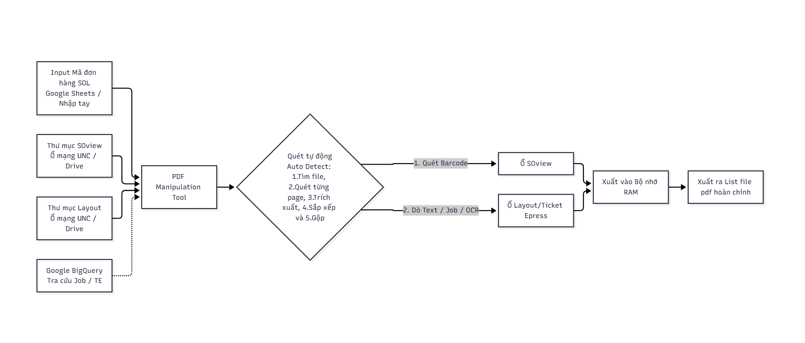
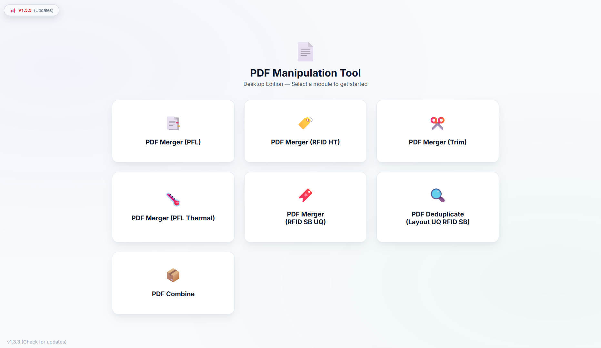
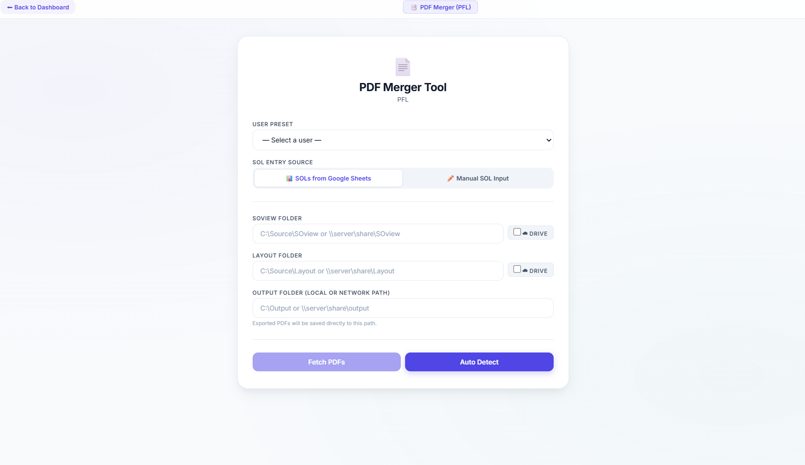
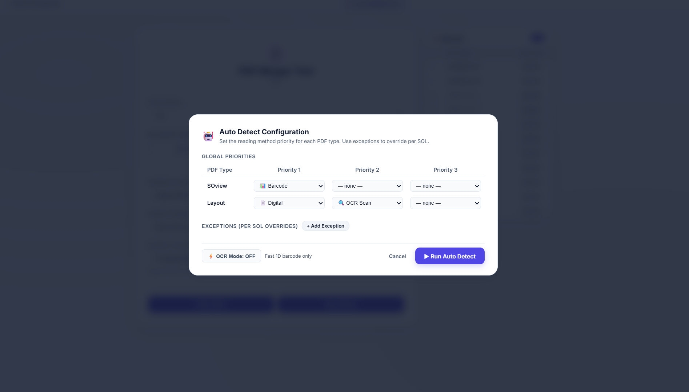
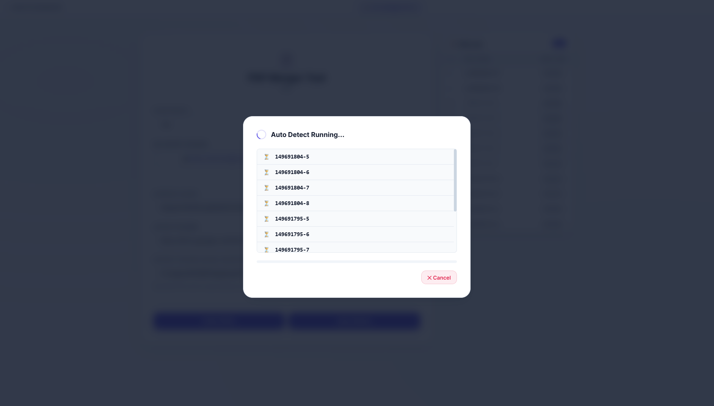
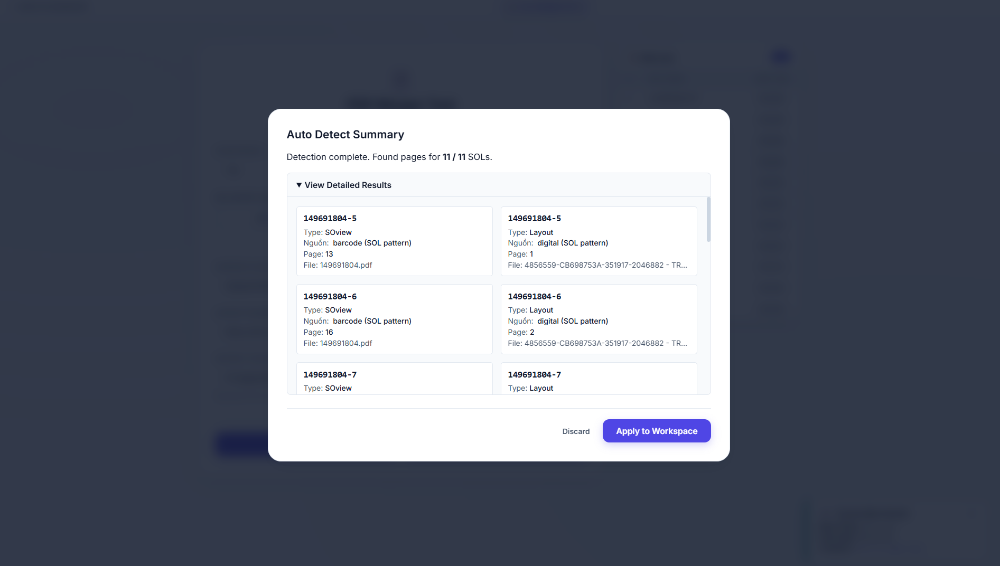
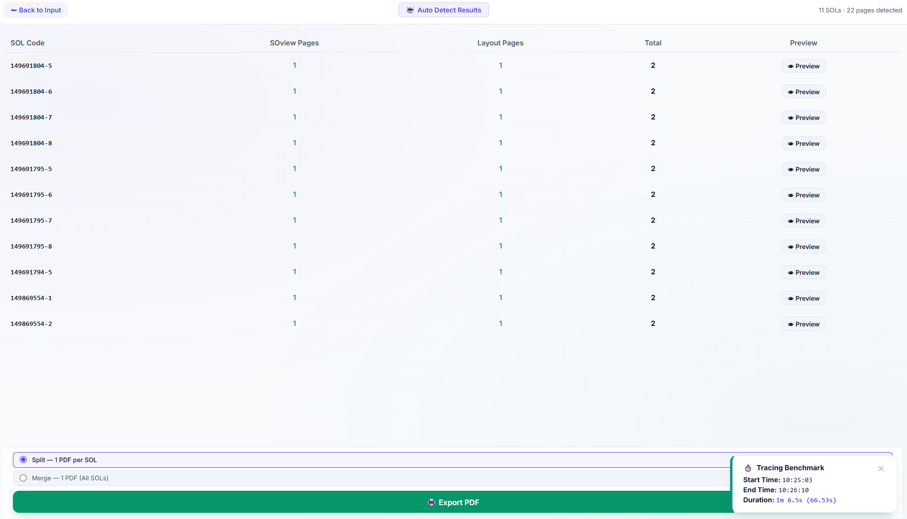
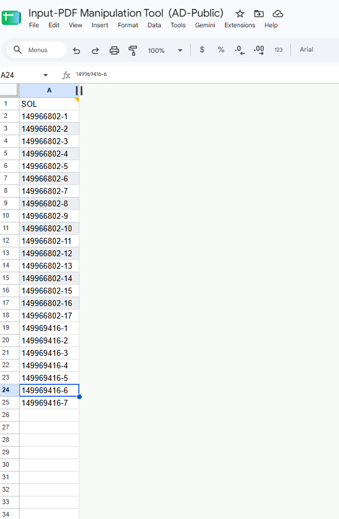
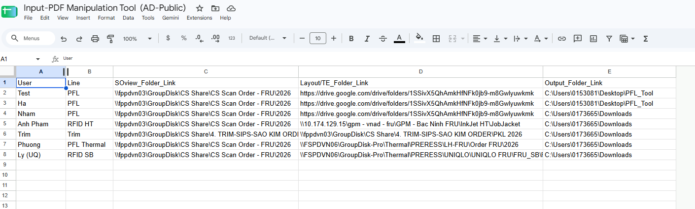

# PDF Manipulation Tool — Desktop Edition 🚀

---

## 📑 Mục lục
1. [Giới thiệu tổng quan](#1-giới-thiệu-tổng-quan)
   - [Bài toán thực tế & Lý do ra đời](#bài-toán-thực-tế--lý-do-ra-đời)
   - [Lợi ích mang lại](#lợi-ích-mang-lại)
2. [Sơ đồ quy trình hoạt động](#2-sơ-đồ-quy-trình-hoạt-động)
3. [Hướng dẫn sử dụng chi tiết các phân hệ PDF Merger (Kèm hình ảnh)](#3-hướng-dẫn-sử-dụng-chi-tiết-các-phân-hệ-pdf-merger)
   - [Bước 1: Màn hình chính (Dashboard)](#bước-1-màn-hình-chính-dashboard)
   - [Bước 2: Màn hình nạp dữ liệu đầu vào (Input Screen)](#bước-2-màn-hình-nạp-dữ-liệu-đầu-vào-input-screen)
   - [Bước 3: Cấu hình quét tự động (Auto Detect Configuration)](#bước-3-cấu-hình-quét-tự-động-auto-detect-configuration)
   - [Bước 4: Tiến trình xử lý dữ liệu (Waiting Screen)](#bước-4-tiến-trình-xử-lý-dữ-liệu-waiting-screen)
   - [Bước 5: Bảng tóm tắt kết quả phát hiện (Summary Screen)](#bước-5-bảng-tóm-tắt-kết-quả-phát-hiện-summary-screen)
   - [Bước 6: Duyệt kết quả & Xuất file PDF (Results & Export Screen)](#bước-6-duyệt-kết-quả--xuất-file-pdf-results--export-screen)
4. [Đặc thù các phân hệ PDF Merger theo chuyền sản xuất](#4-đặc-thù-các-phân-hệ-pdf-merger-theo-chuyền-sản-xuất)
5. [Giới thiệu nhanh các Module khác](#5-giới-thiệu-nhanh-các-module-khác)
   - [PDF Deduplicate (Khử trùng lặp trang)](#pdf-deduplicate)
   - [PDF Combine (Gộp file nhanh)](#pdf-combine)
6. [Technical overview](#6-technical-overview)
   - [Kiến trúc & Công nghệ](#kiến-trúc--công-nghệ)
   - [Cấu trúc thư mục Codebase](#cấu-trúc-thư-mục-codebase)
   - [Cài đặt môi trường phát triển (Dev Setup)](#cài-đặt-môi-trường-phát-triển-dev-setup)
   - [Quy trình đóng gói file .exe](#quy-trình-đóng-gói-file-exe)
7. [Cập nhật tự động (OTA Update) & Xử lý sự cố](#7-cập-nhật-tự-động-ota-update--xử-lý-sự-cố)

---

# 1. Giới thiệu tổng quan

### Bài toán thực tế & Lý do ra đời
Trong các nhà máy in ấn nhãn mác bao bì và sản xuất thẻ thông minh RFID, mỗi lệnh sản xuất gồm hai thành phần tài liệu bắt buộc phải đi liền với nhau:
1. **Lệnh sản xuất / Đơn hàng bán lẻ (SOview):** Thường là một file PDF tổng hợp chứa nhiều đơn hàng khác nhau (Sales Order Line - SOL) dồn cục lại.
2. **Bản vẽ thiết kế & Bố cục in (Layout/Drawing):** Tài liệu kĩ thuật chứa thông tin in lên con nhãn.

**Khó khăn trước đây:**
* Nhân viên phải dùng mắt để tìm từng trang tương ứng cho mã SOL trong file SOview dài hàng trăm trang, rồi mở từng thư mục mạng tìm bản vẽ Layout tương ứng, sau đó in lần lượt tài liệu ra rồi ghép lại với nhau theo SOL.
* Thao tác thủ công mất từ **2 đến 4 tiếng mỗi ngày**, rất dễ nhầm lẫn giữa các mã hàng tương tự nhau.

### Lợi ích mang lại
* ⚡ **Tốc độ vượt trội:** Xử lý hàng chục đơn hàng và duyệt hàng trăm trang PDF.
* 🎯 **Chính xác tuyệt đối:** Quét đọc barcode, OCR, text trên từng page file pdf để lọc page cần dùng.
* ☁️ **Kết nối dữ liệu** Tự động tra cứu mã việc (Job Code) và số Ticket Express (TE) trực tiếp từ kho dữ liệu Google Cloud BigQuery và Google Sheets, tự tìm file theo folder chỉ định và SOL input vào.

---

# 2. Sơ đồ quy trình hoạt động



---

# 3. Hướng dẫn sử dụng chi tiết các phân hệ PDF Merger

Dưới đây là quy trình thao tác chuẩn từ lúc mở phần mềm đến khi xuất file thành công, đi kèm hình ảnh và chú thích chi tiết từng nút bấm trên giao diện.

---

### Bước 1: Màn hình chính (Dashboard)


#### 🔴 Chú thích giao diện & Chức năng từng nút:

| Ký hiệu | Tên nút / Vị trí | Chức năng chi tiết |
| :---: | :--- | :--- |
| **[1]** | **`PDF Merger (PFL)`** | Chuyên dùng để gộp file **SOview** và bản vẽ **Layout** cho dòng sản phẩm nhãn in vải/giấy PFL (Packaging Front Layout). Hỗ trợ tự động tra cứu mã Job trên BigQuery. |
| **[2]** | **`PDF Merger (RFID HT)`** | Chuyên dùng gộp đơn hàng cho dây chuyền **RFID Heat Transfer** (ép nhiệt). Khớp bản vẽ theo mã Job và xử lý cờ Barcode Range Scan. |
| **[3]** | **`PDF Merger (Trim)`** | Dành riêng cho đơn hàng phụ liệu **Trim Adidas**. Tự động kết nối BigQuery lấy số Ticket Express (TE) và bóc tách theo quy tắc 3 mẫu văn bản. |
| **[4]** | **`PDF Merger (PFL Thermal)`** | Dành cho dòng hàng **PFL Thermal** (in nhiệt). Mặc định quét dải trang liên tục cho tất cả đơn hàng. |
| **[5]** | **`PDF Merger (RFID SB UQ)`** | Dành cho dây chuyền sản xuất nhãn **Uniqlo RFID SB**. Khớp chính xác ranh giới mã đơn và lọc trùng trang trực tiếp trong RAM. |
| **[6]** | **`PDF Deduplicate`** | Dùng để lọc bỏ các trang bị lặp lại trong bản vẽ, chỉ giữ lại các trang kích thước và màu sắc duy nhất (*Unique Size-Color*). |
| **[7]** | **`PDF Combine`** | Công cụ gộp nhanh nhiều file PDF rời rạc trong một thư mục thành 1 file duy nhất. |
| **[8]** | **`v1.3.3 (Check for updates)`** *(Góc dưới cùng bên trái)* | Kiểm tra phiên bản mới trên google drive và tự động cập nhật phần mềm khi có bản nâng cấp. |

👉 **Thao tác:** Bấm chuột vào module bạn cần làm việc (ví dụ: bấm vào thẻ **`PDF Merger (PFL)`**).

---

### Bước 2: Màn hình nạp dữ liệu đầu vào (Input Screen)
Sau khi chọn module, màn hình nạp dữ liệu cấu hình sẽ hiện ra.



#### 🔴 Chú thích giao diện & Chức năng từng mục:

| Ký hiệu | Tên trường / Nút bấm | Hướng dẫn thao tác & Chức năng |
| :---: | :--- | :--- |
| **[1]** | **`⬅ Back to Dashboard`** | Quay trở lại màn hình chính Dashboard nếu bạn muốn chọn phân hệ khác. |
| **[2]** | **`📁 Load Sample Data`** | **Chế độ Demo / Offline:** Tự động nạp đường dẫn và dữ liệu mẫu từ thư mục `sample_data/` để trải nghiệm hoặc biểu diễn toàn bộ tính năng mà không cần tài khoản Google Cloud / Service Account Key. |
| **[3]** | **`USER PRESET`** *(Menu thả xuống)* | Chọn tên người dùng của bạn. Phần mềm sẽ tự động điền sẵn các đường dẫn thư mục thường dùng và danh sách đơn hàng đã lưu trên Google Sheets. |
| **[4]** | **`SOL ENTRY SOURCE`** *(Chọn nguồn nạp SOL)* | Có 2 lựa chọn:<br>• **`📊 SOLs from Google Sheets`**: Nạp tự động danh sách đơn hàng từ file Google Sheets.<br>• **`✏️ Manual SOL Input`**: Mở ô văn bản để bạn tự dán hoặc gõ danh sách mã SOL bằng tay. |
| **[5]** | **`SOVIEW FOLDER`** | Nhập đường dẫn thư mục chứa file SOview (ví dụ: `\\server\share\SOview` hoặc `D:\Orders\SOview`).<br>• Tích chọn ô **`☁ DRIVE`** nếu thư mục nằm trên Google Drive. |
| **[6]** | **`LAYOUT FOLDER`** | Nhập đường dẫn thư mục chứa file bản vẽ Layout (ví dụ: `\\server\share\Layout`).<br>• Tích chọn ô **`☁ DRIVE`** nếu layout lưu trên Google Drive. |
| **[7]** | **`OUTPUT FOLDER`** | Đường dẫn thư mục nơi phần mềm sẽ lưu file PDF kết quả sau khi ghép xong (ví dụ: `D:\KetQua_In`). |
| **[8]** | **`Fetch PDFs`** | **Chế độ Thủ công (Manual):** Tải file về không gian làm việc 3 cột, cho phép người dùng tự nhìn từng trang, kéo thả sắp xếp hoặc chọn trang theo ý muốn. |
| **[9]** | **`Auto Detect`** | **(Tính năng chính - khuyên dùng)** Hệ thống tự động đọc mã vạch, phân tích trang và ghép tự động |

👉 **Thao tác:** Kiểm tra đường dẫn thư mục, sau đó bấm nút **`Auto Detect`** để bắt đầu quy trình tự động.

---

### Bước 3: Cấu hình quét tự động (Auto Detect Configuration)
Khi bấm nút `Auto Detect`, một hộp thoại cấu hình sẽ hiển thị cho phép bạn tinh chỉnh phương pháp nhận diện tài liệu.



#### 🔴 Chú thích chi tiết các tùy chọn:

| Thành phần | Ý nghĩa & Hướng dẫn sử dụng |
| :--- | :--- |
| **`GLOBAL PRIORITIES`** *(Thứ tự ưu tiên)* | Xác định phương pháp ưu tiên để đọc tài liệu:<br>• **SOview:** Mặc định ưu tiên `Barcode`.<br>• **Layout:** Mặc định ưu tiên `Digital` (đọc văn bản số trực tiếp) $\rightarrow$ sau đó tới `OCR Scan` (nhận diện OCR nếu là file scan). |
| **`+ Add Exception`** | Dùng trong trường hợp đặc biệt: Cho phép bạn chỉ định riêng một số mã SOL cá biệt dùng phương pháp đọc khác với số đông còn lại. |
| **`⚡ OCR Mode: OFF`** *(Nút chuyển đổi chế độ cho foler SOview)* | • **OFF (Mặc định):** Chạy bằng cách chỉ quét Barcode 1D và ký tự số có sẵn.<br>• **ON:** Bật chế độ quét hình ảnh OCR nhận diện văn bản trong trường hợp file PDF là dạng ảnh chụp mờ hoặc bản scan lại, scan bị ngược, lệch,... |
| **`Cancel`** | Hủy bỏ và đóng hộp thoại cấu hình. |
| **`▶ Run Auto Detect`** | **Bắt đầu kích hoạt:** Bấm vào đây để hệ thống bắt đầu quét và phân tích file. |

---

### Bước 4: Tiến trình xử lý dữ liệu (Waiting Screen)
Trong lúc phần mềm đang phân tích và tìm kiếm file, màn hình chờ tiến độ sẽ xuất hiện.



#### 🔴 Quan sát tiến độ:
* **Vòng xoay `Auto Detect Running...`:** Ứng dụng đang kích hoạt xử lý đa luồng trên máy tính, đồng thời truy vấn dữ liệu từ BigQuery / ổ đĩa chia sẻ.
* **Danh sách mã SOL:** Mỗi mã đơn hàng sẽ có trạng thái:
  * ⏳ **Đang xử lý / Đang chờ:** Ứng dụng đang quét trang cho mã đơn này.
  * ✔️ **Hoàn tất:** Đã tìm thấy trang tương ứng.
* **Nút `✕ Cancel`:** Cho phép bạn dừng tiến trình ngay lập tức nếu phát hiện chọn nhầm thư mục hoặc muốn đổi danh sách mã.

---

### Bước 5: Bảng tóm tắt kết quả phát hiện (Summary Screen)
Ngay sau khi quét xong, phần mềm sẽ hiển thị bảng tóm tắt kết quả phát hiện.



#### 🔴 Cách đọc thông tin trên bảng tóm tắt:
* **Dòng thông báo chung:** Báo cáo tổng quan số lượng tìm thấy (Ví dụ: `Detection complete. Found pages for 11 / 11 SOLs.` nghĩa là 100% đơn hàng đã tìm thấy đầy đủ trang).
* **Các thẻ chi tiết từng SOL:**
  * Thẻ bên trái: Thông tin trang **SOview** tìm được (Số trang, tên file gốc, phương thức tìm thấy như barcode).
  * Thẻ bên phải: Thông tin trang **Layout** tìm được (Số trang bản vẽ, tên file gốc, tìm theo mã Job hay mã SOL).
* **Nút `Discard`:** Hủy bỏ kết quả quét này nếu bạn muốn quét lại.
* **Nút `Apply to Workspace`:** Xác nhận và chuyển toàn bộ các trang đã ghép sang màn hình kiểm tra kết quả cuối cùng.

---

### Bước 6: Duyệt kết quả & Xuất file PDF (Results & Export Screen)
Đây là màn hình quan trọng nhất trước khi xuất file PDF thành phẩm ra đĩa.



#### 🔴 Chú thích giao diện & Các nút chức năng:

| Ký hiệu | Tên chức năng | Chi tiết hoạt động |
| :---: | :--- | :--- |
| **[1]** | **`⬅ Back to Input`** | Quay lại màn hình nhập liệu ban đầu nếu cần bổ sung đơn hàng. |
| **[2]** | **Bảng danh sách kết quả** | Liệt kê chi tiết từng dòng đơn hàng:<br>• **`SOL Code`**: Mã đơn hàng.<br>• **`SOview Pages`**: Số lượng trang đơn hàng tìm thấy (hiển thị số xanh).<br>• **`Layout Pages`**: Số lượng trang bản vẽ tìm thấy (hiển thị số xanh).<br>• **`Total`**: Tổng số trang sẽ được ghép cho đơn hàng này. |
| **[3]** | **Nút `👁 Preview`** | Bấm vào để xem trước ảnh chụp thực tế của các trang đã ghép nối cho đơn hàng đó trước khi in, đảm bảo không có sai sót. |
| **[4]** | **Tùy chọn: `◉ Split — 1 PDF per SOL`** | **Xuất riêng từng đơn:** Mỗi mã SOL sẽ xuất ra một file PDF độc lập (Tên file tự động đặt theo chuẩn: `MãSOL.pdf`) |
| **[5]** | **Tùy chọn: `○ Merge — 1 PDF (All SOLs)`** | **Gộp tất cả vào 1 file:** Toàn bộ các đơn hàng sẽ được nối liên tiếp vào chung một file PDF duy nhất. Tên file theo danh sách các mã đơn hàng. |
| **[6]** | **Nút `💾 Export PDF`** *(Nút xanh lá lớn)* | **NÚT XUẤT FILE CHÍNH:** Bấm vào đây để phần mềm tiến hành trích xuất và lưu các file PDF hoàn chỉnh vào thư mục `OUTPUT FOLDER` đã chỉ định. |
| **[7]** | **Hộp `⏱ Tracing Benchmark`** *(Góc dưới bên phải)* | Bảng đồng hồ đo hiệu năng hiển thị thời gian bắt đầu, kết thúc và tổng thời gian thực hiện (Ví dụ: xử lý 11 đơn hàng 22 trang chỉ mất `1m 6.5s`). |

---

# 4. Đặc thù các phân hệ PDF Merger theo chuyền sản xuất

Mỗi phân hệ Merger được tinh chỉnh thuật toán riêng để phù hợp tuyệt đối với quy cách in của từng xưởng:

| Tên Module | Dây chuyền phục vụ | Đặc điểm thuật toán & Nghiệp vụ chuyên sâu |
| :--- | :--- | :--- |
| **PDF Merger (PFL)** | Chuyền in nhãn Packaging Front Layout | • Hỗ trợ đọc cả mã SOL hoặc cặp (SOL, Job code 8 số).<br>• Tự động truy vấn BigQuery `raw_ingest.get_Job` nếu thiếu số Job.<br>• Cơ chế dò kép (*Dual-strategy*): Dò trang layout theo mã Job trước, nếu không có tự động chuyển sang dò theo mã SOL. |
| **PDF Merger (RFID HT)** | Chuyền ép nhiệt RFID Heat Transfer | • Đọc bảng tính 4 cột (`SOL`, `Job`, `RB`, `Flag`).<br>• Khớp bản vẽ Layout 1-1 theo mã `Job` trực tiếp trên ổ mạng UNC mà không cần OCR.<br>• Quét dải trang liên tục (*Barcode Range Scan*) cho các đơn có `Flag=True`. |
| **PDF Merger (Trim)** | Phụ liệu may mặc Trim | • Kết nối BigQuery gọi stored procedure `raw_ingest.get_TE`.<br>• Tự động trích xuất mã Ticket Express (10 chữ số).<br>• Phân tích SOview qua 3 mẫu regex (`*SO*`, `FOR MFG/PURCHASE X/Y`, `Page X of Y`), đối chiếu mã vạch văn bản `*TE*` và tự động ghép cặp chính xác. |
| **PDF Merger (PFL Thermal)** | Chuyền nhãn in nhiệt Thermal | • Tự động áp dụng chế độ quét dải barcode liên tục cho toàn bộ đơn hàng.<br>• Tự động vô hiệu hóa OCR để tối ưu hóa thời gian xử lý nhanh nhất. |
| **PDF Merger (RFID SB UQ)** | Thẻ treo Uniqlo RFID SB | • Quét kho layout mạng với cơ chế ranh giới tuyệt đối, tránh hiện tượng nhận diện nhầm các chuỗi ký tự con.<br>• Tải trước file đa luồng và khử trùng lặp trang (*Cluster-Jump*) ngay trong bộ nhớ RAM. |

Ví dụ cách set up file input SOL trên google sheets:



Ví dụ cách set up file input Userpreset trên google sheets:



---

# 5. Giới thiệu nhanh các Module khác

Ngoài các phân hệ Merger chuyên sâu, ứng dụng còn cung cấp 2 công cụ tiện ích phụ trợ:

### PDF Deduplicate
* **Mục đích:** Dành cho các file bản vẽ kỹ thuật lớn chứa nhiều trang lặp lại giống hệt nhau về nội dung (chỉ khác số lượng nhãn hoặc bị nhân bản trang).
* **Cách hoạt động:** Sử dụng thuật toán nhảy cụm lũy thừa kết hợp tìm kiếm nhị phân (*Cluster-Jump Binary Search*). Thay vì phải đọc từng trang $O(N)$, thuật toán chỉ cần đọc $O(K \log(N/K))$ trang,

### PDF Combine
* **Mục đích:** Công cụ tổng hợp nhanh khi có nhiều file PDF rời rạc nằm trong các thư mục con khác nhau và muốn gom lại thành 1 file tổng duy nhất (hoặc theo nhóm mã hàng)

---

# 6. Technical overview

Phần này cung cấp thông tin kỹ thuật phục vụ việc bảo trì, phát triển mở rộng hoặc đánh giá mã nguồn.

### Kiến trúc & Công nghệ
Ứng dụng được xây dựng theo mô hình **Hybrid Desktop-Web (Kiến trúc lai máy tính - web)**:
* **GUI Host:** `pywebview 6.2.1` nhúng engine **Microsoft Edge Chromium (WebView2)** nguyên bản trên Windows.
* **Backend:** Python 3.12+ (CPython 64-bit).
* **WSGI Server nội bộ:** `bottle 0.13.4` đóng vai trò micro-server cục bộ phục vụ assets và hiển thị ảnh thu nhỏ (thumbnail) từ thư mục `%TEMP%`.
* **Xử lý PDF:** `PyMuPDF (fitz) 1.28.2` — thư viện C siêu tốc chịu trách nhiệm giải mã vector, trích xuất trang và kết xuất ảnh DPI.
* **Xử lý Barcode & OCR:** `pyzbar` (thư viện C libzbar-64). Requirement: Cài Visual C++ 2013 x64 Redistributable; `pytesseract OCR` bọc quanh engine Google Tesseract v5. Requirement: Cài Tesseract OCR for Windows.
* **Tích hợp Cloud:** Google Cloud SDK (`google-cloud-bigquery`, `gspread`, `google-api-python-client`) chạy xác thực tài khoản dịch vụ (Service Account JWT).
* **Frontend:** Vanilla HTML5, Modern CSS (Glassmorphism), Vanilla JavaScript ES6+ (Zero-framework).

### Cấu trúc thư mục Codebase

```text
pdf_manipulation_desktop/
│
├── main.py                             # Điểm khởi chạy ứng dụng (Khởi tạo WebView2, Bottle server, Bridge API)
├── build.spec                          # Cấu hình đóng gói PyInstaller (Bundling file, hiddenimports, UPX)
├── version_info.txt                    # Metadata nhị phân Windows PE (Version, Copyright, Company)
├── requirements.txt                    # Danh sách các thư viện Python phụ thuộc
├── CHANGELOG.md                        # Lịch sử cập nhật và thay đổi qua các phiên bản
├── Documents.md                        # Tài liệu đặc tả kỹ thuật chi tiết & giải thuật hệ thống
├── README.md                           # Hướng dẫn sử dụng và giới thiệu tổng quan dự án
├── LICENSE                             # Giấy phép bản quyền mã nguồn
│
├── backend/                            # Tầng xử lý logic nghiệp vụ trung tâm (Core Python Engine)
│   ├── __init__.py                     # Định danh package Python
│   ├── bridge.py                       # Cầu nối IPC (BridgeApi) giữa giao diện JS và Python, điều phối đa luồng
│   ├── constants.py                    # Quản lý hằng số tập trung: Regex mẫu, GCP IDs, cấu hình đường dẫn
│   ├── bigquery_service.py             # Dịch vụ truy vấn BigQuery: Gọi các Stored procedures
│   ├── file_resolver.py                # Phân giải & quét file PDF từ ổ đĩa chia sẻ UNC nội bộ và Google Drive
│   ├── pdf_detector.py                 # Backend tự động nhận diện: Quét Barcode 1D, Text số, OCR Tesseract
│   ├── pdf_deduplicator.py             # Backend khử trùng lặp trang bản vẽ (Thuật toán Cluster-Jump Binary Search)
│   ├── pdf_combiner.py                 # Backend gộp nhiều file PDF rời rạc theo thư mục và mã đơn hàng
│   ├── pdf_processor.py                # Backend xử lý PDF PyMuPDF (fitz): Render thumbnail, cắt ghép vector PDF
│   ├── trim_service.py                 # Backend nghiệp vụ module Trim : Quét mẫu SOview 3 regex và đối chiếu mã TE
│   ├── sample_service.py               # Backend quản lý nạp dữ liệu mẫu (Sample/Demo Data) cho chế độ Offline/Demo
│   ├── sheets_service.py               # Kết nối Google Sheets API: Đọc danh sách User Presets và danh sách SOL
│   ├── updater.py                      # Backend cập nhật từ xa OTA: Kiểm tra phiên bản Google Drive & cập nhật nền
│   └── window_utils.py                 # Tiện ích Windows Win32 API qua ctypes: Nhấp nháy thanh Taskbar thông báo
│
├── assets/                             # Frontend (Presentation Layer - WebView2)
│   ├── index.html                      # Cấu trúc giao diện ứng dụng Single Page (SPA)
│   ├── styles.css                      # CSS (Glassmorphism, Dark/Light palettes, Responsive)
│   ├── app.js                          # Logic tương tác UI: Quản lý trạng thái, DOM ảo, gọi API Bridge
│   ├── icon.ico                        # Icon ứng dụng trên Windows
│   └── vendor/                         # Thư viện JavaScript hỗ trợ giao diện
│       ├── sortable.min.js             # Hỗ trợ kéo - thả (Drag & Drop) sắp xếp trang PDF thủ công
│       └── split.min.js                # Hỗ trợ kéo giãn kích thước các cột giao diện (Resizable gutters)
│
├── config/                             # Cấu hình và chứng thực ứng dụng
│   ├── credentials.json.example        # File mẫu cấu hình Service Account Key của Google Cloud
│   └── version.json                    # Version tool
│
└── pictures/                           # Hình ảnh chụp màn hình và sơ đồ minh họa tài liệu README
```

### Cài đặt môi trường phát triển (Dev Setup)

1. **Yêu cầu hệ điều hành:** Windows 10 hoặc Windows 11 (64-bit), đã cài Python 3.12+ (hoặc 3.13/3.14).
2. **Khởi tạo môi trường ảo & Cài đặt thư viện:**
   ```powershell
   # Tạo môi trường ảo
   python -m venv venv
   
   # Kích hoạt môi trường ảo
   .\venv\Scripts\Activate.ps1
   
   # Cài đặt toàn bộ dependencies
   pip install -r requirements.txt
   ```
3. **Cấu hình chứng thực Google Cloud:**
   * Tạo bản sao file mẫu: `copy config\credentials.json.example config\credentials.json`
   * Điền thông tin Service Account Key có quyền đọc Google Sheets, Drive và BigQuery vào `config/credentials.json`.

### Quy trình đóng gói file .exe
Dự án sử dụng file cấu hình [build.spec](file:///c:/Users/1228411/Desktop/Merger%20Tool/pdf_manipulation_desktop%20(Github)/build.spec) chuẩn hóa cho PyInstaller:

```powershell
# Chạy lệnh đóng gói
.\venv\Scripts\python.exe -m PyInstaller --noconfirm build.spec
```
* **Kết quả:** File thực thi độc lập duy nhất sẽ được xuất ra tại `dist/PDF Manipulation v1.3.3.exe`.

---

# 7. Cập nhật tự động (OTA Update) & Xử lý sự cố

### Cơ chế cập nhật phiên bản không dây (Over-The-Air)
* Mỗi khi khởi động, ứng dụng sẽ âm thầm đối chiếu số hiệu phiên bản trong `config/version.json` với file `version.json` trên thư mục Google Drive của quản trị viên.
* Khi có bản phát hành mới, huy hiệu thông báo màu đỏ sẽ sáng lên ở góc màn hình Dashboard.
* Khi người dùng nhấn nút cập nhật, ứng dụng sẽ tải gói cập nhật về thư mục tạm, tự động kích hoạt script nền thay thế file `.exe` cũ và khởi động lại phiên bản mới một cách mượt mà.

---

**Author:** [@thijnhhh](https://github.com/Thijnhhh) — Phung Duc Thinh (*Build for internal use-only*)
